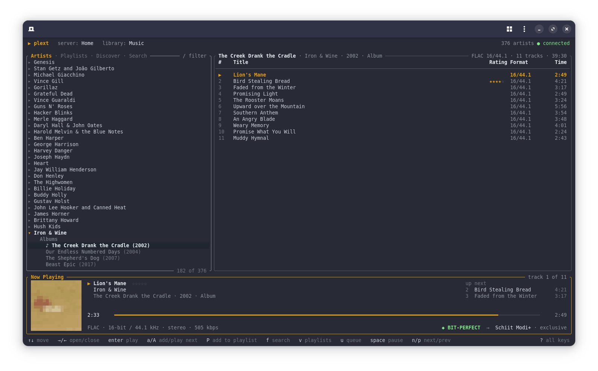

# Plext

A terminal music player for Plex with bit-perfect playback straight to your DAC.
Browse your album artists and albums, stream lossless and high-res audio untouched,
all from a single static binary for Linux.



## Features

- **Bit-perfect output.** Plays the original file from your server (no transcoding), decodes it,
  and writes the samples unchanged to the DAC through ALSA's `hw:` device. The DAC is switched to
  each track's native sample rate and resampling is disabled. The now-playing bar shows
  **◆ BIT-PERFECT** only when every bit reaches the DAC unaltered.
- **Or play through your desktop's sound.** If you'd rather listen on any speakers or headphones
  alongside other apps, Plext can play through PipeWire or PulseAudio instead. Setup asks which
  you want, and `plext output` switches any time.
- **Gapless playback** between tracks of the same format; the next track is pre-fetched.
- **A play queue** you can add albums and tracks to, reorder and trim, with shuffle and repeat.
  It's saved when you quit and comes back paused where you left off.
- **Discover: stations and mixes.** Plex's stations (Library Radio, Deep Cuts and more), track
  radio and artist mixes built from Plex's sonic analysis, sonic adventures from one track to
  another, and the shelves your library offers, like Recently Played. Stations and mixes keep
  going until you play something else.
- **Your Plex playlists**: browse and play them, add to them, make new ones, reorder, rename and
  delete. Changes are saved to Plex, so they show up in Plexamp and the Plex apps too.
- **Formats:** FLAC, ALAC, WAV, AIFF (lossless), plus MP3, AAC, Vorbis.
- **All release types**: albums, EPs, singles, live albums, compilations and more, grouped under
  headings when you expand an artist (using the release types Plex reads from your tags, the same
  classification MusicBrainz uses).
- **Reports playback to Plex** like official players do, so plays show up in Plex's dashboard and
  history, count toward play counts, and trigger webhooks (`media.play`, `media.pause`,
  `media.resume`, `media.stop`, `media.scrobble`).
- **Track ratings.** See and set your Plex star ratings (half stars included) in the track list
  and the now-playing bar. Ratings are shared with Plex and Plexamp.
- **Album art as pixel art.** The playing album's cover, drawn right in the terminal beside
  what's playing, square in whatever font you use.
- **Desktop media controls (MPRIS).** Plext shows up in your desktop's media controls (GNOME's
  top bar and lock screen, KDE's media applet) with the track and album cover, and the keyboard's
  play/pause, next and previous keys control it.
- **Plex sign-in with a link code**, automatic server discovery, LAN and remote connections.
- **Single static binary**: no dependencies to install.

## Requirements

- Linux on x86_64 (any distribution; the binary has no dependencies)
- A Plex Media Server with a music library, and a Plex account
- For bit-perfect playback, a USB DAC or other sound card that Plext can access directly.
  For desktop sound, PipeWire (with pipewire-pulse, the default on current distributions) or
  PulseAudio
- Plex Pass only if you want Plex webhooks; everything else works without it

## Install

Download `plext-x86_64-linux.tar.gz` from the [Releases](../../releases) page, then:

```sh
tar xzf plext-x86_64-linux.tar.gz
sudo install plext /usr/local/bin/
```

To upgrade, download the new release and run the same two commands; your settings are kept.

## Getting started

```sh
plext login          # sign in at plex.tv/link, pick your server, library and how to play
plext                # start playing
```

The first time, Plext asks how to play your music:

- **Bit-perfect**: straight to your DAC through ALSA, untouched. Plext has the DAC to itself
  while it plays, and you set the volume on the DAC or amp. Best with a USB DAC.
- **Desktop sound**: through PipeWire or PulseAudio, to whatever speakers or headphones your
  desktop uses, alongside other apps and with your usual volume controls. Never bit-perfect,
  since the sound server mixes and converts the audio.

Then it asks which device or output to use. Change either later:

```sh
plext output                       # ask again
plext output system                # switch to desktop sound
plext output bitperfect            # switch to bit-perfect
plext device                       # list the devices for the current mode
plext device hw:CARD=DAC,DEV=0     # bit-perfect: choose your DAC
plext device default               # desktop sound: follow the desktop's default output
```

In bit-perfect mode, if no device is set, Plext picks the first USB audio device it finds. In
desktop-sound mode it follows your desktop's default output unless you pick one, so it moves to
your headphones when the desktop does. You can also move Plext to another output from your
sound settings while it plays.

## Commands

| Command | What it does |
| --- | --- |
| `plext` | Start the player (runs `login` first if you haven't signed in) |
| `plext login` | Sign in at plex.tv/link and choose a server and music library |
| `plext logout` | Forget the saved Plex sign-in |
| `plext output` | Choose bit-perfect or desktop sound; `plext output bitperfect` / `plext output system` sets it directly |
| `plext device` | List output devices for the current mode; `plext device <name>` sets the default |
| `plext status` | Show the server, library, output mode, device, and config and log file locations |
| `plext inspect "Artist"` | Show what your server reports about an artist's releases |
| `plext inspect mixes` | Show what your server offers for mixes, stations and sonic features (read-only) |
| `plext --device <name>` | Play through a different device for this session only |
| `plext --output <mode>` | Use the other mode (`bitperfect` or `system`) for this session only |

## Keys

The bottom line of the screen shows the keys for wherever you are. Press `?` (or `F1`) for a
window listing every shortcut.

| Key | Action |
| --- | --- |
| `↑` `↓` / `j` `k` | Move |
| `PgUp` `PgDn` | Move a page |
| `Home` `End` / `g` `G` | Jump to the top / bottom |
| `→` / `l` | Expand an artist; on an album or playlist, move to its track list |
| `←` / `h` | Collapse / back to the artist list |
| `Enter` | Play the album or playlist (in the track list, from the selected track), replacing the queue |
| `v` | Switch the left pane: Artists → Playlists → Discover |
| `a` | Add the album or track to the end of the queue |
| `A` | Play the album or track next, right after the current track |
| `P` | Add the album, track or playlist to a playlist, or start a new one |
| `m` | Start a mix: track radio from the highlighted track, an artist mix from an artist (or from what's playing) |
| `M` | Sonic adventure from what's playing to the highlighted track |
| `u` | Show the queue (press again, or `←`, to go back) |
| `z` | Shuffle on / off |
| `r` | Repeat: off → the whole queue → this track → off |
| `Space` | Pause / resume |
| `n` / `p` | Next / previous track (`p` restarts the track if you're more than 3 s in) |
| `.` `]` / `,` `[` | Seek forward / back 10 s |
| `s` | Stop (the queue stays; `Space` starts it again) |
| `1`–`5` | Rate the track that many stars |
| `-` / `=` | Take away / add half a star (`+` works too) |
| `0` | Clear the track's rating |
| `Tab` | Switch pane |
| `/` | Filter the list: artists or playlists (`Esc` clears) |
| `?` / `F1` | Show every shortcut |
| `q` / `Ctrl+C` | Quit |

## The queue

Pressing `Enter` on an album plays it, replacing whatever was queued. To line up more, press `a`
on an album or a track to add it to the end of the queue, or `A` to have it play next, right
after the current track. If nothing is playing, `Space` starts the queue.

Press `u` to see the queue in the right-hand pane. Tracks already played stay at the top,
dimmed, so `p` can go back to them; the playing track is marked ▶. There:

| Key | Action |
| --- | --- |
| `Enter` | Play the highlighted track now |
| `d` / `Delete` | Remove the track from the queue |
| `J` / `K` | Move the track down / up |
| `c` | Clear everything after the playing track |
| `S` | Save the queue as a new playlist |
| `P` | Add the highlighted track to a playlist |
| `u` / `←` | Back to the album view |

**Shuffle** (`z`) keeps the playing track and shuffles the rest of the queue; turning it off
puts the original order back. With shuffle on, playing an album starts with the track you chose
and shuffles the rest. **Repeat** (`r`) cycles through off, the whole queue, and the current
track. Both show at the top right of the now-playing bar, and in your desktop's media controls.

When you quit, the queue is saved to `~/.local/state/plext/queue.json`. Next time Plext starts
with it paused at the same track and position; press `Space` to carry on. (A queue saved from a
different Plex server is ignored.)

## Playlists

Press `v` to switch the left pane from your artists to your playlists (and back). Plext lists the
audio playlists with music from the library you chose; smart playlists are marked *smart*.
Select one to see its tracks on the right. Playlists play and queue just like albums: `Enter`
plays one (replacing the queue), `a` adds it to the queue, and `A` plays it next.

Big playlists (Plex's own smart playlists can run to thousands of tracks) load in pages: the
first couple of hundred tracks show straight away, and the title counts up as the rest arrive.
You don't have to wait. `Enter` or `a` starts with what's loaded, and the rest joins the queue
as it comes in, mixed in at random if shuffle is on.

To add to a playlist, press `P` on an album, a track, a playlist, or a track in the queue. A
window lists your playlists, plus **New playlist…**, which asks for a name. In the queue view,
`S` saves the whole queue as a new playlist.

| Key | Where | Action |
| --- | --- | --- |
| `d` / `Delete` | A playlist's tracks | Remove the track from the playlist |
| `J` / `K` | A playlist's tracks | Move the track down / up |
| `R` | The playlist list | Rename the playlist |
| `D` | The playlist list | Delete the playlist (asks first) |

Changes show at once and are saved to your Plex server in the background, so they appear in
Plexamp and the Plex apps too; if one can't be saved, Plext says so and shows the playlist as the
server has it. Smart playlists are built by Plex from rules, so their tracks can't be edited
(you can still play, rename or delete them). Plext fetches the list again each time you switch
to it, so playlists changed elsewhere show up.

## Discover

Press `v` until the left pane shows **Discover**. It has three parts:

- **Stations** are your Plex server's own, such as Library Radio, Deep Cuts Radio and Time Travel
  Radio. `Enter` plays one.
- **Mixes** start from the track that's playing: **Track radio** plays tracks that sound like it,
  and **Artist mix** plays that artist and artists who sound like them, a few tracks each.
  `Enter` starts one. **Sonic adventure** explains the `M` key (below).
- **Your library** lists the shelves your server suggests, like Recently Played, Recently Added,
  Most Played in December or Haven't Played in 5 Months. `→` opens one on the right: `Enter` plays
  an album or opens an artist in the Artists view, and `a` / `A` queue an album.

You don't have to go to Discover to start a mix: press `m` on any track (in an album, a playlist
or the queue) for track radio, or on an artist for an artist mix. With nothing highlighted, `m`
starts track radio from what's playing.

**Stations and mixes keep going.** When the queue gets down to its last few tracks, Plext adds
more, skipping ones it has already queued, until you play something else (or clear the queue
with `c`). The queue view shows which mix is running.

**Sonic adventure** (`M`): highlight any track and press `M`, and the queue travels from the track
that's playing to that one, through tracks whose sound lies in between. What's playing carries on;
the path replaces what was queued after it.

Mixes and sonic adventures use Plex's sonic analysis, which needs Plex Pass and sonic analysis
turned on in your Plex server's settings for the music library. `plext inspect mixes` shows what
your server offers.

## Plex integration

While you listen, Plext reports progress to your server every 10 seconds and whenever you play,
pause, skip or stop. Plex marks a track as played (and sends `media.scrobble`) once you're about
90% of the way through. Webhooks require Plex Pass and are configured on the server.

To turn reporting off, add this to `~/.config/plext/config.toml`:

```toml
report_playback = false
```

## Album art

The now-playing area shows the album's cover as pixel art, drawn with half-block characters
(two pixels per character cell). It is 16 pixels tall, and as many wide as your font needs for
the picture to come out square: Plext asks the terminal how tall its character cells are
compared with their width (a narrow font needs more columns). Plext asks your server for the
cover, averages it down and cuts it to a 16-color palette for a crisp, hand-made look. Covers are cached in
`~/.cache/plext/covers`, the same cache the desktop's media controls use.

Beside the cover are the title and your rating, the artist, and the album with its year and
release type; then the progress bar and a line with the source format and where it's playing
(◆ BIT-PERFECT → your DAC). With room to spare, an "up next" column lists the next two tracks.

The layout follows the size of your terminal:

| Terminal size | Now-playing area |
| --- | --- |
| under 90×30 (e.g. the usual 80×24 default) | compact three-line bar |
| 90×30 and larger | cover, track details, progress, format and output |
| about 100 columns and wider | the above, plus "up next" |

It looks best in a terminal with 24-bit color (GNOME Terminal, Konsole, kitty, WezTerm,
Alacritty, foot…); elsewhere Plext uses the nearest of the standard 256 colors. With
`album_art = false`, Plext always uses the compact bar.

## Media keys and desktop controls

While Plext runs, it registers with your desktop as a media player over MPRIS, the standard
Linux desktops use for this. GNOME and KDE then show the playing track, artist, album and cover
in their media controls, and route the keyboard's media keys to Plext: play/pause, next,
previous and stop. Seeking, shuffle and repeat work from those controls too (`playerctl shuffle
toggle`, `playerctl loop Playlist`). Volume isn't offered there: in
bit-perfect mode it's up to your DAC or amp, and in desktop-sound mode your desktop's own volume
controls work as usual.

On window managers without built-in media controls (sway, i3, Hyprland…), bind your keys to
[`playerctl`](https://github.com/altdesktop/playerctl), for example in sway:

```
bindsym XF86AudioPlay exec playerctl -p plext play-pause
bindsym XF86AudioNext exec playerctl -p plext next
bindsym XF86AudioPrev exec playerctl -p plext previous
```

Album covers are downloaded from your server into `~/.cache/plext/covers` (the newest 400 are
kept) and handed to the desktop as local files, so your Plex token never leaves Plext. Over SSH
or on a console with no desktop session there's nothing to register with, and Plext simply
carries on without it. To turn it off, set `mpris = false`.

## Ratings

Plext shows your rating for each track in the track list and next to the title in the
now-playing bar, on Plex's five-star scale. A dimmer star is a half star, so ★★★★ with a dim
fifth star is 4½. Unrated tracks have a blank rating column.

The rating keys apply to the highlighted track while the track list has focus, and to the
playing track while the artist list has focus. The stars change straight away and the rating is
saved to Plex in the background; if Plex can't save it, the old rating comes back and the error
shows in the now-playing bar.

Ratings live on your server, so they're the same in Plex, Plexamp and Plext. Plexamp's
"One Star" (like/dislike) rating style isn't supported. Each time you open an album, Plext
fetches its tracks again, so ratings changed elsewhere show up. Plex also shares one rating
between copies of the same recording (for example a song on its album and on a compilation),
and you'll see that too.

## Options

Settings live in `~/.config/plext/config.toml` (`plext status` shows the path). The file also
holds your Plex sign-in token, so Plext keeps it readable only by you.

| Option | Default | What it does |
| --- | --- | --- |
| `output` | `bitperfect` | `bitperfect` (ALSA, straight to the DAC) or `system` (PipeWire/PulseAudio); set it with `plext output` |
| `device` | first USB DAC | ALSA device for bit-perfect mode; set it with `plext device <name>` |
| `sink` | desktop default | PipeWire/PulseAudio output for desktop-sound mode; set it with `plext device <name>` |
| `report_playback` | `true` | Report playback to Plex (dashboard, history, webhooks) |
| `group_releases` | `true` | Group an artist's releases under headings (Albums, EPs, Live…). With `false`, they're one list, oldest first |
| `album_art` | `true` | Show the album cover as pixel art in a taller now-playing area |
| `mpris` | `true` | Show in the desktop's media controls and obey media keys |

## Bit-perfect notes

These apply in bit-perfect mode. In desktop-sound mode, Plext sends each track to the sound
server in its own sample rate and bit depth, and the server takes it from there.

- **Exclusive access.** While Plext is playing, the DAC is reserved for it. Other sounds won't play
  through it, and Plext releases the device when playback stops.
- **Volume** stays at full digital scale; use your DAC's or amplifier's volume control.
- **Narrower DAC containers.** 16-bit sources sent to a 32-bit-only DAC are padded with zero bits,
  which preserves every original bit. If a DAC can't accept a source's bit depth or sample rate
  natively, Plext tells you rather than converting silently.
- **Lossy files** (MP3, AAC, Vorbis) play normally but are never shown as bit-perfect.
- **DSD** isn't supported yet.

## Troubleshooting

- **"Device is busy."** Your desktop sound server (PipeWire or PulseAudio) is holding the DAC.
  Stop other audio, or set the DAC's profile to *Off* in your sound settings
  (e.g. `pavucontrol` → Configuration) while you listen. If you don't need bit-perfect playback,
  `plext output system` plays through the sound server instead.
- **"No PipeWire or PulseAudio server found."** Desktop-sound mode needs a running sound server
  with its PulseAudio socket; on PipeWire systems that's the `pipewire-pulse` service
  (`systemctl --user status pipewire-pulse`).
- **A track was skipped, or something flashed by.** Errors stay on screen for 15 seconds and are
  written to `~/.local/state/plext/plext.log`, along with each track played and any dropped
  connections Plext recovered from.
- **Can't reach the server.** Plext tries the server's other addresses automatically. If your
  server moved or your sign-in expired, run `plext login` again.
- **Media keys don't do anything.** Check that Plext is registered with `playerctl -l` (it lists
  `plext`). If another player also runs, your desktop may send the keys to that one instead.
- **A release is in the wrong group.** Plext uses the release type Plex reads from your tags.
  `plext inspect "Artist"` shows what the server reports for each release.

## Building from source

Requires Rust and the ALSA development package (`libasound2-dev` on Debian/Ubuntu,
`alsa-lib-devel` on Fedora).

```sh
cargo build --release
cargo test --release   # bit-perfect and interface tests; needs ffmpeg
```

The tests encode random audio with ffmpeg, stream it through Plext's download, decode and
output path (including the real ALSA output code, captured with ALSA's `file` device), and check
every byte matches the source. If a PipeWire or PulseAudio server is running, the desktop-sound
output is also tested against it (playing a second and a half of silence).

Desktop sound talks to the sound server over its PulseAudio socket in pure Rust, with no extra
system libraries, so the release binary stays static.

## License

Plext is released under the [MIT License](LICENSE). The release binary also includes
third-party libraries under their own licenses, listed in
[THIRD-PARTY-LICENSES.md](THIRD-PARTY-LICENSES.md). If you change Plext's dependencies,
regenerate that file with `cargo about generate about.hbs -o THIRD-PARTY-LICENSES.md`
(install with `cargo install cargo-about --features cli`).

## About this project

Plext was built with Claude, Anthropic's AI model, under the direction of Noah Duffy, and is
tested on real hardware. The bit-perfect claims are backed by the automated tests described
above, which run on every build.

Plext is an independent project and is not affiliated with or endorsed by Plex, Inc.
